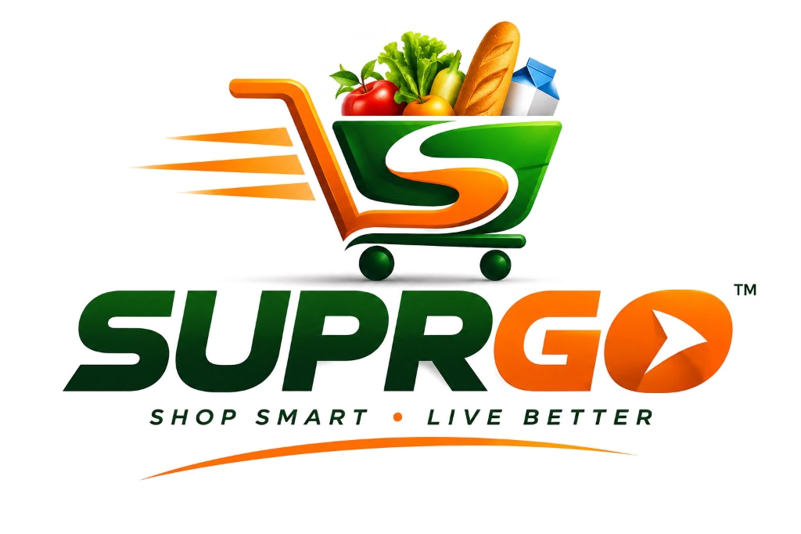

# 🛒 SuprGo: Shop Smart • Live Better | 3D Immersive Two-Floor Supermarket

An interactive, first-person **Two-Floor 3D Supermarket Shopping Experience** built with React, Three.js, React Three Fiber, Tailwind CSS, Web Audio API, and Node.js.



Customers can physically walk through store aisles, take the **working 3D lift** to the **1st Floor Fashion Boutique**, push an interactive shopping trolley, inspect and pick products from shelves, adjust quantities or remove items at any location, dock at any of **three dedicated billing counters**, watch animated cashiers scan items on the laser conveyor belt, download an itemized PDF invoice, and complete their purchase via a Razorpay-ready payment gateway.

---

## 🌟 Major Features

### 1. Official SuprGo Brand Identity
- **Official Brand Logo & Slogan**: "SUPRGO: SHOP SMART • LIVE BETTER" integrated across the 3D store entrance facade, top navigation HUD, loading screens, live trolley drawer, catalog, and digital PDF receipt.
- **Visual Equalizer HUD**: Top-bar quick toggle with animated live equalizer wave bars.

### 2. High-Fidelity Soothing Supermarket Music
- **Web Audio Procedural Lounge Engine**: Authentic supermarket lofi background music featuring warm polyphonic Rhodes electric piano chords, mellow upright bass (audible on phones & laptops), and sparkling vibraphone/chime melodies.
- **Reliable Autoplay & AudioContext Unlocking**: Automatically initializes on any user interaction (click, touch, or key) and instantly resumes when toggled in the HUD or settings.

### 3. Two Functional Retail Floors & 3D Lift
- **Ground Floor (Grocery Supermarket)**: Fresh fruits & vegetables, cold dairy cabinets, grains & staples, snacks & beverages, household cleaning & personal care, and 3 checkout counter lanes.
- **1st Floor (Fashion & Apparel Boutique)**: Luxury herringbone wood flooring, boutique track lighting, men's denim & formal shirts, women's dresses & blazers, backlit sneaker showcase wall, and luxury handbags.
- **Working 3D Lift (`Elevator3D.tsx`)**: Physical elevator shaft (`X=0, Z=-11.5`) with real vertical cabin translation, sliding doors, elevator chime, motor sounds, floor call buttons, and synchronized camera/trolley elevation.

### 4. Effortless Product Addition & Removal
- **Direct Shelf Controls**: Looking at any item shows `[ + ]`, `[ − ]`, and `[ Remove ]` buttons.
- **Everywhere Removal**: Easily remove any product from your trolley at any time via the persistent Live Trolley drawer, shelf HUD, or convenience catalog.
- **Live 3D Trolley Synchronization**: Items stack or disappear inside the physical wire basket in real time.

### 5. Desktop & Mobile Responsiveness
- **Desktop**: WASD movement, mouse look, Alt cursor toggle, and keyboard shortcuts.
- **Mobile**: Virtual analog joystick (bottom-left), touch swipe camera (right half), and thumb-friendly action buttons.

---

## 🎮 Controls Summary

| Control | Action |
|---|---|
| **W, A, S, D** / Arrows | Walk around aisles & floors |
| **Mouse / Touch Swipe** | Look around in 360° |
| **Alt** | Toggle Free Cursor / 3D Look Mode |
| **E / Tap Button** | Pick up product / Call or ride Lift |
| **Tab** | Convenience Catalog Mode (78 Products) |
| **F** | Inspect product specifications & nutrition |
| **Q** | Quick Search products across both floors |
| **L** | Shopping Checklist |
| **C** | Open Live Trolley Drawer |
| **ESC** | Store Settings & Audio Controls |

### 7. Digital Invoice & Razorpay Payment Gateway
- Itemized receipt with Subtotal, GST (9% CGST + 9% SGST), discounts, and timestamp.
- **Downloadable PDF Invoice**: Printable receipt generated using `jsPDF`.
- **Payment Sandbox**: Supports UPI (Google Pay, PhonePe, Paytm, QR Code), Credit/Debit Cards, and Net Banking with backend verification (`POST /api/payment/verify`).

---

## 🎮 Controls Summary

| Key | Action |
|---|---|
| **W, A, S, D** / Arrows | Walk around the supermarket |
| **Shift** | Sprint |
| **Mouse Look** | 360° Camera Look (Click to lock) |
| **E** | Pick up product / Dock trolley at any counter |
| **Tab** | Toggle Convenience Catalog Mode |
| **F** | 3D Inspect product (Ingredients & Reviews) |
| **Q** | Quick Search products |
| **L** | Open Shopping List Checklist |
| **C** | Open Shopping Trolley Drawer |
| **ESC** | Open Settings & Menu / Release Mouse |

---

## 🚀 Quick Start Guide

### 1. Start Both Backend & Frontend
```bash
npm run dev
```
- Backend REST API: `http://localhost:5000`
- Frontend 3D App: `http://localhost:5173`
